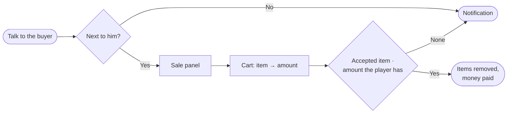

<div align="center">



<br>


**NPC buyers that pay a fixed price for items from the player's inventory.**
Pick quantities in a cart, sell everything in one click, and let the server decide every price.

[Features](#-features) · [How it works](#-how-it-works) · [Installation](#-installation) · [Configuration](#-configuration) · [License](#-license)

</div>

---

## ✨ Features

<table>
<tr>
<td width="50%" valign="top">

### 🧍 Buyers anywhere
Add as many buyers as you want in `Config.Buyers`: ped model, position, scenario, map blip and, optionally, the list of items that buyer accepts.

### 🛒 Cart sale
JVL Steel Blue panel with item pictures, what the player has of each item, a quantity selector, an "all" button and the total. Items the player does not have are dimmed.

### 🖼️ Your logo
`Config.LogoUrl` shows your logo in the header. Leave it empty to show the `Config.Icon` Font Awesome icon instead.

</td>
<td width="50%" valign="top">

### 🛡️ Server-side sale
Prices come only from the config. The server checks the distance to the buyer, caps every quantity at what the player really has, takes the items first and pays only what was removed. One sale per second per player.

### 💵 Cash or bank
`Config.PayAccount` pays to `cash` or `bank` on Qbox, QBCore and ESX.

### 🌐 Auto language, any framework
Texts in each player's GTA V language (es / en). Qbox, QBCore and ESX detected automatically; ox_inventory, qb-inventory or ESX inventory; ox_target or qb-target.

</td>
</tr>
</table>

## 🔄 How it works



The client only sends the buyer number and the cart. The total in the panel is a preview: the server recomputes it from `Config.Items`, so prices cannot be changed from the client.

<details>
<summary><b>📁 Project structure</b></summary>

<br>

| Path | Contents |
| --- | --- |
| `fxmanifest.lua` | Resource manifest (no `dependencies` block) |
| `config.lua` | Framework, language, target, distances, account, logo/icon, items, buyers, notification |
| `locales/es.lua` · `locales/en.lua` | Every text of notifications and the panel |
| `shared/utils.lua` | Framework detection, language, `L()`, price list per buyer |
| `server/main.lua` | Inventory and money calls per framework, open and sell callbacks |
| `client/main.lua` | Peds, blips, target, sale panel |
| `web/` | NUI (`index.html`, `style.css`, `script.js`, `jvl-steel-blue.css`) |
| `assets/readme/` | README banner (not loaded in game) |

</details>

## 🚀 Installation

1. Download this repository into your `resources` folder as `jvl_sales`.
2. Check that every item in `Config.Items` exists in your inventory.
3. Add it to `server.cfg` after your framework and inventory (it declares no dependencies, the order is enough):

```cfg
ensure ox_lib
ensure ox_inventory
ensure qbx_core
ensure jvl_sales
```

**Required:** `ox_lib`, and Qbox, QBCore or ESX. **Optional:** `ox_inventory` (pictures and labels), `ox_target` / `qb-target`, `jvl_notify` (falls back to ox_lib notifications).

## 🔐 Configuration

```lua
Config.PayAccount = 'cash'   -- 'cash' | 'bank'
Config.MaxPerSale = 1000     -- max units of one item per sale
Config.LogoUrl = 'https://.../logo.png'  -- '' = use Config.Icon
Config.Icon = 'fa-solid fa-recycle'

-- Items the buyers take (label is optional, the inventory label is used otherwise)
Config.Items = {
    { item = 'scrapmetal', price = 25 },
    { item = 'empty_bottle', price = 10 },
}

-- Buyers (items = nil -> this buyer takes every item above)
Config.Buyers = {
    {
        label = 'Venta de Materiales',
        ped = { model = 'a_m_y_salton_01', coords = vector4(-340.63, -1543.86, 27.72, 100.05), scenario = 'WORLD_HUMAN_CLIPBOARD' },
        blip = { sprite = 365, colour = 2, scale = 0.8 }, -- false = no blip
        items = { 'scrapmetal', 'empty_bottle' },
    },
}
```

---

## 📄 License

Released under the **MIT License** — free to use, modify and share, keeping the copyright notice. See [`LICENSE`](LICENSE).

© 2026 JVL MediaCode

---

<div align="center">

Made by **[JVL MediaCode](https://jvlmediacode.com)** · Jose M. Valenzuela · Meoqui, Chihuahua, México

<sub><a href="mailto:contacto@jvlmediacode.com">contacto@jvlmediacode.com</a> · <a href="https://discord.gg/m2spgxkPfj">Discord</a></sub>

</div>
